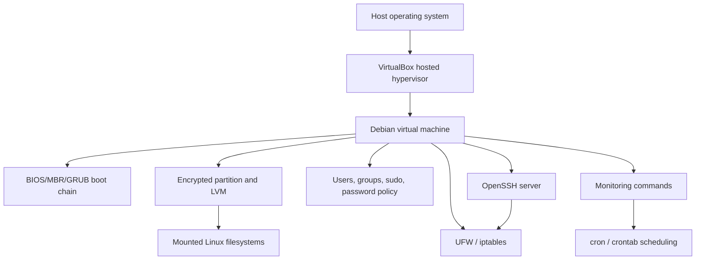

# Born2beroot

A documentation-first implementation guide for the **Born2beroot** system-administration project from the [42 School](https://42.fr) curriculum.

The repository explains how to build and secure a Debian-based Linux virtual machine, covering virtualization, storage layout, user and privilege management, SSH, firewalling, scheduled monitoring, and core boot and networking concepts.

> **Repository scope:** This is primarily a collection of Markdown notes, diagrams, screenshots, and the original project subject. It does not currently contain an application, reusable provisioning scripts, automated tests, or a Docker-based runtime.

## Contents

- [Overview](#overview)
- [Features and learning areas](#features-and-learning-areas)
- [Repository contents](#repository-contents)
- [Conceptual architecture](#conceptual-architecture)
- [Prerequisites](#prerequisites)
- [Getting started](#getting-started)
- [Using the documentation](#using-the-documentation)
- [System configuration reference](#system-configuration-reference)
- [Monitoring and cron](#monitoring-and-cron)
- [Optional services](#optional-services)
- [Validation checklist](#validation-checklist)
- [Testing and code quality](#testing-and-code-quality)
- [Deployment](#deployment)
- [Troubleshooting](#troubleshooting)
- [Roadmap](#roadmap)
- [Contributing](#contributing)
- [License](#license)
- [Author](#author)

## Overview

Born2beroot is a hands-on infrastructure project focused on creating a Linux server inside a virtual machine and hardening it according to the project requirements. The notes are intended for 42 students, Linux learners, and anyone who wants a structured reference for foundational system administration tasks.

The material covers:

- Installing and booting a headless Debian virtual machine.
- Understanding VirtualBox and hosted hypervisors.
- Partitioning disks with encrypted storage and LVM.
- Managing packages with APT, `aptitude`, and `dpkg`.
- Creating users and groups and applying least-privilege access.
- Configuring `sudo` and auditing administrative commands.
- Securing SSH access and disabling direct root login.
- Configuring UFW and understanding its relationship with `iptables`.
- Scheduling system monitoring with `cron`.
- Understanding Linux filesystems, mount points, TCP, BIOS, MBR, and GRUB.

## Features and learning areas

- **Virtualization:** Virtual machines, VirtualBox, and hypervisor fundamentals.
- **Boot process:** BIOS, MBR, GRUB, `/boot`, and operating-system startup.
- **Storage:** Manual partitioning, encrypted volumes, mount points, filesystems, and LVM.
- **Package management:** Debian packages, repositories, APT, `aptitude`, and `dpkg`.
- **Identity and access:** Users, groups, password aging, password complexity, and `sudo`.
- **Remote administration:** OpenSSH client/server roles and SSH configuration files.
- **Network security:** UFW rules, `iptables` concepts, TCP, and restricted service ports.
- **Monitoring:** A documented Bash monitoring example reporting CPU, memory, disk, LVM, users, network, TCP connections, and `sudo` activity.
- **Reference material:** Screenshots, diagrams, the official assignment subject, and concept notes.

## Repository contents

```text
.
├── Born2broot/
│   ├── image/                         # Screenshots and diagrams used by the notes
│   ├── BIOS.md                        # BIOS and hardware initialization
│   ├── Born2broot.md                  # Main virtualization and Debian setup notes
│   ├── Cron.md                        # Cron concepts and crontab examples
│   ├── Dependencies.md                # Dependency definition
│   ├── GRUB (Grand Unified Bootloader).md
│   ├── Hypervisor.md                  # Hypervisor types and VirtualBox context
│   ├── LVM.md                         # Physical volumes, volume groups, and LVs
│   ├── Lighttpd.md                    # Optional web-server reference
│   ├── Master Boot Record (MBR).md
│   ├── Mount Point.md
│   ├── Operating Oystem.md            # Operating-system fundamentals
│   ├── Package(.deb).md
│   ├── Repository.md                   # Debian repository concepts
│   ├── SSH (Secure Shell Host).md      # SSH concepts and key exchange
│   ├── Sudo.md                         # Privilege elevation and auditing
│   ├── TCP (Transmission Control Protocol).md
│   ├── TCP Header.md
│   ├── TTY.md
│   ├── UFW (Uncomplicated Firewall).md
│   ├── WordPress.md                   # Optional CMS reference
│   ├── boot.md
│   ├── filesystem.md
│   ├── iptables.md
│   ├── ssh_config.md                   # SSH client configuration
│   └── sshd_config.md                  # SSH server configuration
├── README.md
└── Subject.pdf                         # Project subject supplied with the repository
```

Several Markdown files use Obsidian-style wiki links such as `[[LVM]]` and image references. On GitHub, those links may not resolve automatically; the directory listing above provides stable navigation to the corresponding files.

## Conceptual architecture

This repository documents a system rather than implementing a software service. The following diagram summarizes the documented relationships between the major layers:



## Prerequisites

The repository does not define pinned tool versions. The documented workflow requires:

- A host operating system capable of running VirtualBox.
- [VirtualBox](https://www.virtualbox.org/) or another compatible hosted hypervisor.
- A Debian installation image compatible with the current Born2beroot subject.
- Basic familiarity with a terminal and shell commands.
- Sufficient host resources for a virtual machine and its virtual disk.

The exact disk sizes, partitioning requirements, hostname conventions, password policy, and bonus requirements must be taken from [`Subject.pdf`](Subject.pdf) and the current evaluation rules.

## Getting started

This is a guided virtual-machine project rather than a package with an application server. A safe high-level setup sequence is:

1. Clone the repository:

   ```bash
   git clone https://github.com/A-chem/42-Cursus-Born2beroot.git
   cd 42-Cursus-Born2beroot
   ```

2. Read the official requirements in [`Subject.pdf`](Subject.pdf).
3. Review the main setup notes in [`Born2broot/Born2broot.md`](Born2broot/Born2broot.md).
4. Create a new VM in VirtualBox and install Debian without a graphical interface, following the subject requirements.
5. Configure the disk layout, encryption, LVM logical volumes, filesystems, and mount points required by the subject.
6. Install and configure the required administration and security tools inside the VM:
   - `sudo`
   - OpenSSH server
   - UFW and/or the firewall configuration required by the subject
   - `libpam-pwquality` for password-quality enforcement
   - Git and Vim, where required for the setup workflow
7. Apply the documented hostname, user, group, password-aging, SSH, and firewall settings.
8. Configure the monitoring command or script and schedule it with `cron` if required.
9. Validate the VM using the checklist below and the official subject.

> **Security warning:** The notes contain example commands and historical sample values. Never reuse example passwords, encryption passphrases, or credentials in a real system. Use unique secrets and avoid committing them to Git.

## Using the documentation

Recommended reading order:

1. [`Subject.pdf`](Subject.pdf) — authoritative project requirements.
2. [`Born2broot/Born2broot.md`](Born2broot/Born2broot.md) — end-to-end installation and configuration notes.
3. [`Born2broot/Hypervisor.md`](Born2broot/Hypervisor.md) — VM and hypervisor concepts.
4. [`Born2broot/LVM.md`](Born2broot/LVM.md), [`Born2broot/filesystem.md`](Born2broot/filesystem.md), and [`Born2broot/Mount Point.md`](Born2broot/Mount%20Point.md) — storage concepts.
5. [`Born2broot/Sudo.md`](Born2broot/Sudo.md), [`Born2broot/TTY.md`](Born2broot/TTY.md), and [`Born2broot/ssh_config.md`](Born2broot/ssh_config.md) / [`Born2broot/sshd_config.md`](Born2broot/sshd_config.md) — access control and SSH.
6. [`Born2broot/UFW (Uncomplicated Firewall).md`](Born2broot/UFW%20(Uncomplicated%20Firewall).md) and [`Born2broot/iptables.md`](Born2broot/iptables.md) — network filtering.
7. [`Born2broot/Cron.md`](Born2broot/Cron.md) — scheduling and monitoring.

### Useful verification commands

Run these **inside the VM** after the relevant components have been configured:

```bash
# Operating system and hostname
uname -a
hostnamectl

# Storage and mount layout
lsblk
findmnt

# Users and groups
id <username>
groups <username>
getent group sudo

# Services
systemctl status ssh
systemctl status cron

# SSH listener and firewall
ss -tuln
sudo ufw status numbered

# Password aging for a user
sudo chage -l <username>
```

Replace `<username>` with a real non-root account on your VM. Do not paste passwords or private keys into documentation or issue reports.

## System configuration reference

### Storage and boot

The documented storage path is:

1. Create the required partition table and partitions.
2. Create an encrypted partition when required by the subject.
3. Use LVM to create a volume group and logical volumes.
4. Format logical volumes with the required filesystem and assign mount points.
5. Install GRUB on the required boot device.
6. Verify the result with `lsblk` and `findmnt`.

The notes discuss logical volumes for `/`, swap, `/home`, `/var`, `/srv`, `/tmp`, and `/var/log`; the exact sizes must follow the assignment requirements rather than the examples in the notes.

### Users, groups, and sudo

The documented hardening approach includes:

- Creating a regular user based on the 42 login convention.
- Creating or using the required user group.
- Adding the administrative user to `sudo` only when required.
- Enforcing password aging and complexity through `/etc/login.defs` and PAM configuration.
- Limiting authentication attempts and recording `sudo` activity.
- Using `visudo` to validate sudoers changes.

Always keep a recovery path available before changing authentication or sudo configuration. A syntax error in `/etc/sudoers` or PAM configuration can prevent administrative access.

### SSH

The notes distinguish between:

- `/etc/ssh/ssh_config`: client-side configuration.
- `/etc/ssh/sshd_config`: server-side configuration.

The documented server configuration uses a non-default SSH port (`4242`) and disables direct root login. Confirm the port required by the subject before applying it, then validate the configuration and restart the SSH service:

```bash
sudo sshd -t
sudo systemctl restart ssh
sudo ss -tuln | grep 4242
ssh <username>@<vm-ip> -p 4242
```

If VirtualBox port forwarding is used, configure the host and guest ports consistently and keep an existing console session open until remote access has been verified.

### Firewall

The notes describe UFW as a simpler interface over `iptables`. A typical verification flow is:

```bash
sudo ufw status numbered
sudo ufw allow 4242/tcp
sudo ufw enable
```

Only allow ports required by the VM and the subject. Do not enable a firewall remotely until the active SSH port has been allowed and tested.

## Monitoring and cron

The main notes document a Bash monitoring example that broadcasts a status report with `wall`. The report gathers information using commands including `uname`, `nproc`, `free`, `df`, `top`, `uptime`, `lsblk`, `ss`, `who`, `hostname`, `ip`, and `journalctl`.

The notes also show a ten-minute cron schedule and an `@reboot` example. No standalone `monitoring.sh` file is currently stored in the repository, so the examples must be adapted and tested in the VM before use.

To inspect and edit the current user’s cron jobs:

```bash
crontab -l
crontab -e
```

For root-owned monitoring jobs, use the appropriate root crontab only when required:

```bash
sudo crontab -l
sudo crontab -e
```

## Optional services

The repository includes short reference notes for [Lighttpd](Born2broot/Lighttpd.md) and [WordPress](Born2broot/WordPress.md), corresponding to optional or bonus service topics in the project context. These files do not provide a complete, verified application deployment, database configuration, or production web-server setup.

Do not assume that Lighttpd or WordPress is installed or running on the VM unless you configure and verify it yourself.

## Validation checklist

Use the official subject as the source of truth and confirm, as applicable:

- [ ] The VM boots successfully and the required encryption prompt works.
- [ ] The hostname follows the project requirement.
- [ ] Required partitions, logical volumes, filesystems, and mount points exist.
- [ ] The regular user and required groups exist.
- [ ] Password aging and complexity rules are active.
- [ ] `sudo` works for the intended user and logs administrative activity.
- [ ] Root SSH login is disabled when required.
- [ ] SSH listens on the required port.
- [ ] The firewall is enabled and exposes only required ports.
- [ ] The monitoring output contains the required system metrics.
- [ ] The monitoring job is scheduled at the required interval.
- [ ] Optional services are installed only when explicitly required and are independently tested.

## Testing and code quality

There is currently no automated test suite, linter, formatter, CI workflow, package manifest, or build script in the repository. Validation is therefore manual and should be performed with the commands in this README, the notes in `Born2broot/`, and the official subject.

For documentation changes, check that:

- Relative links resolve to the intended files.
- Shell commands are safe, complete, and clearly scoped to the VM.
- No real credentials, private keys, or host-specific secrets are committed.
- Markdown code fences, tables, and headings render correctly on GitHub.

## Deployment

There is no application deployment target or production runtime defined by this repository. The intended environment is a local Linux virtual machine managed through VirtualBox. If you adapt the material for a hosted server, review every storage, SSH, firewall, authentication, and recovery step for that provider before applying it.

## Troubleshooting

### SSH access fails after changing the port

- Check the server configuration with `sudo sshd -t`.
- Confirm the SSH service is running: `sudo systemctl status ssh`.
- Confirm the listener: `sudo ss -tuln`.
- Confirm the firewall allows the configured TCP port.
- Check VirtualBox port forwarding if connecting through the host.

### The VM is locked out after a firewall change

Use the VM’s local console to inspect `sudo ufw status numbered` and restore the required SSH rule. Keep a local console session open while changing remote-access rules.

### `sudo` no longer works

Use a root or recovery-console session and validate the sudoers file with `visudo`. Review recent changes to `/etc/sudoers`, `/etc/sudoers.d/`, PAM configuration, and group membership.

### A mount point or logical volume is missing

Inspect the storage graph with `lsblk`, active mounts with `findmnt`, and filesystem metadata with `blkid`. Compare the result with the subject’s required layout before modifying partitions.

### The monitoring command prints incomplete values

Run each pipeline component separately, then check command availability, permissions, locale-dependent output, and whether the command is being executed from the intended user’s environment or crontab.

## Roadmap

No formal roadmap is currently defined. Reasonable future improvements, clearly outside the verified current scope, could include:

- Replacing Obsidian-only links with GitHub-compatible relative links.
- Adding a dedicated, sanitized monitoring script.
- Adding a reproducible validation checklist or shell-based audit helper.
- Organizing screenshots into topic-specific subdirectories.
- Adding a contribution guide and a license.

## Contributing

Contributions that improve technical accuracy, clarity, accessibility, or GitHub compatibility are welcome.

1. Fork the repository.
2. Create a focused branch:

   ```bash
   git checkout -b docs/improve-ssh-guide
   ```

3. Make the smallest coherent change and preserve the existing topic structure where practical.
4. Check Markdown links and code blocks locally or in GitHub’s preview.
5. Remove secrets, personal credentials, and machine-specific identifiers.
6. Commit with a clear message:

   ```bash
   git add README.md Born2broot/
   git commit -m "docs: improve SSH configuration guide"
   ```

7. Push the branch and open a pull request describing what changed and how it was verified.

## License

No license file is present in the repository, and no license is declared in the repository metadata. Until a license is added, reuse and redistribution permissions should be treated as **unspecified**.

## Author

**A-chem** — 42 School student

- GitHub: [@A-chem](https://github.com/A-chem)

## Acknowledgments

- [42 School](https://42.fr) for the Born2beroot project and curriculum context.
- [Debian](https://www.debian.org/) for the operating system and package-management ecosystem documented by the project.
- [VirtualBox](https://www.virtualbox.org/) for the hosted virtualization workflow referenced in the notes.
